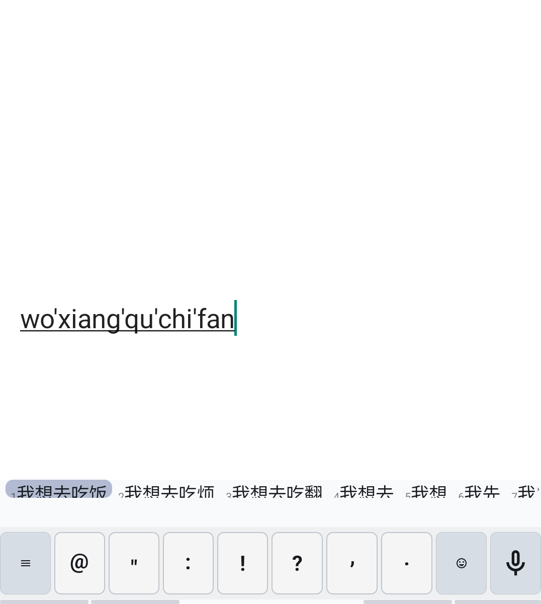
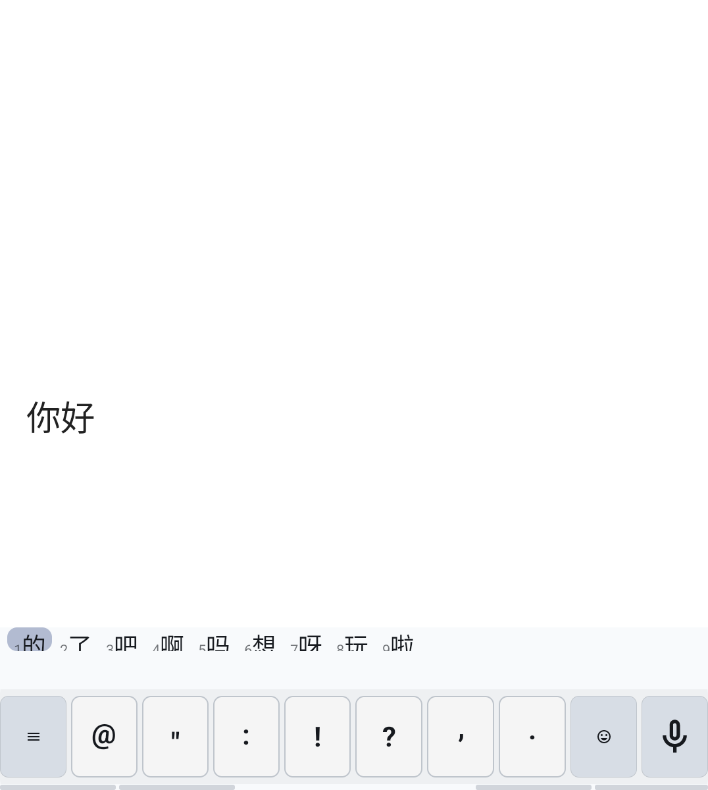
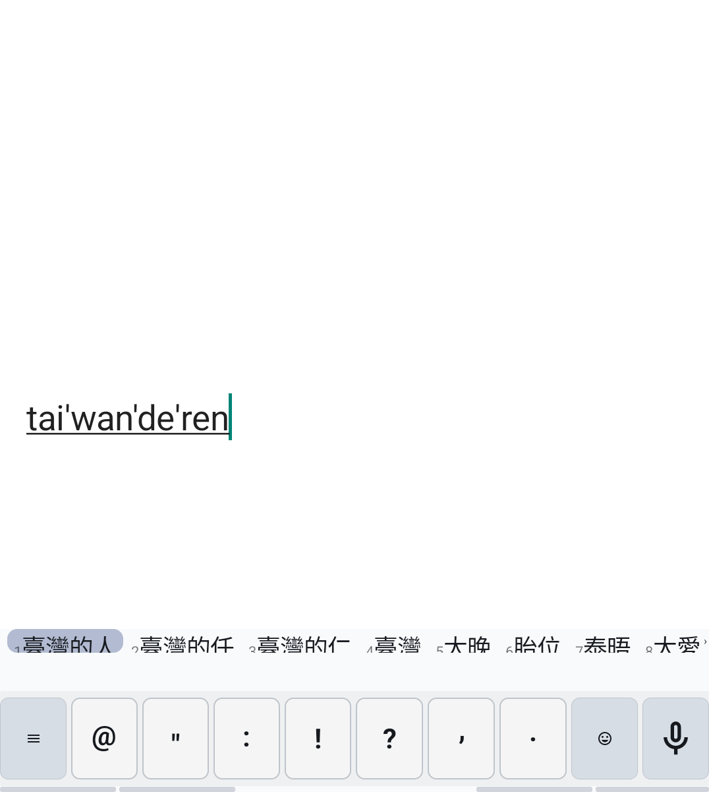
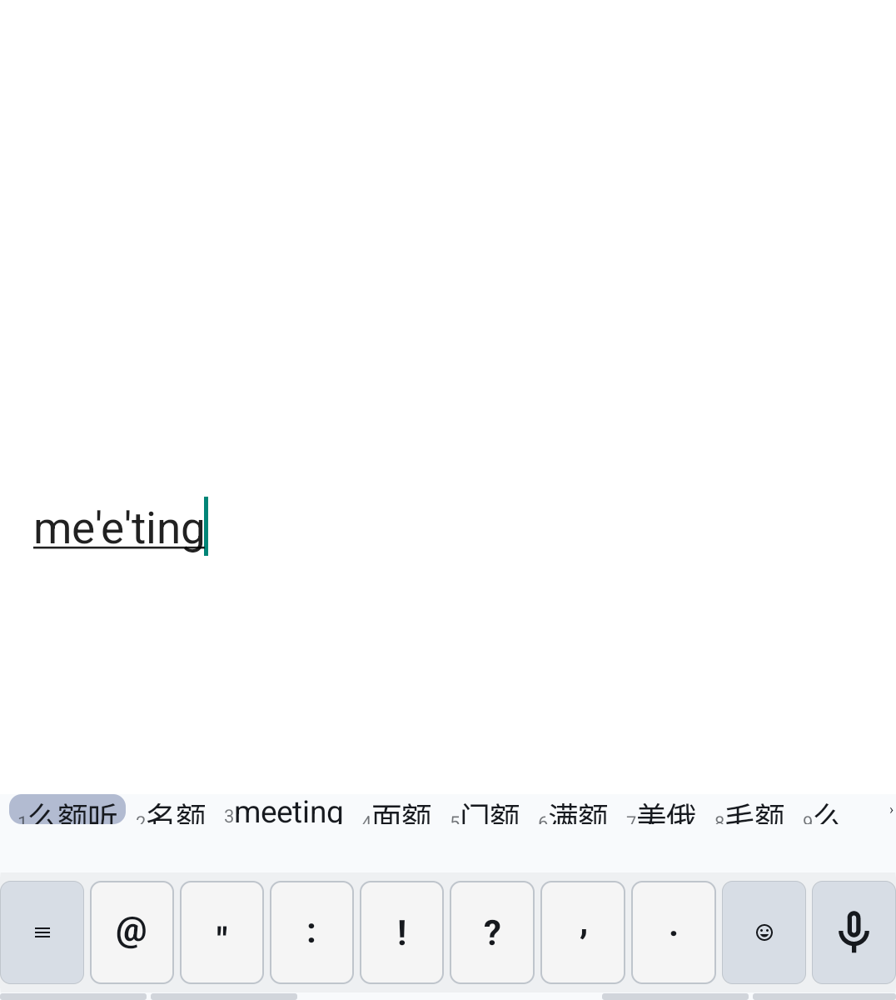
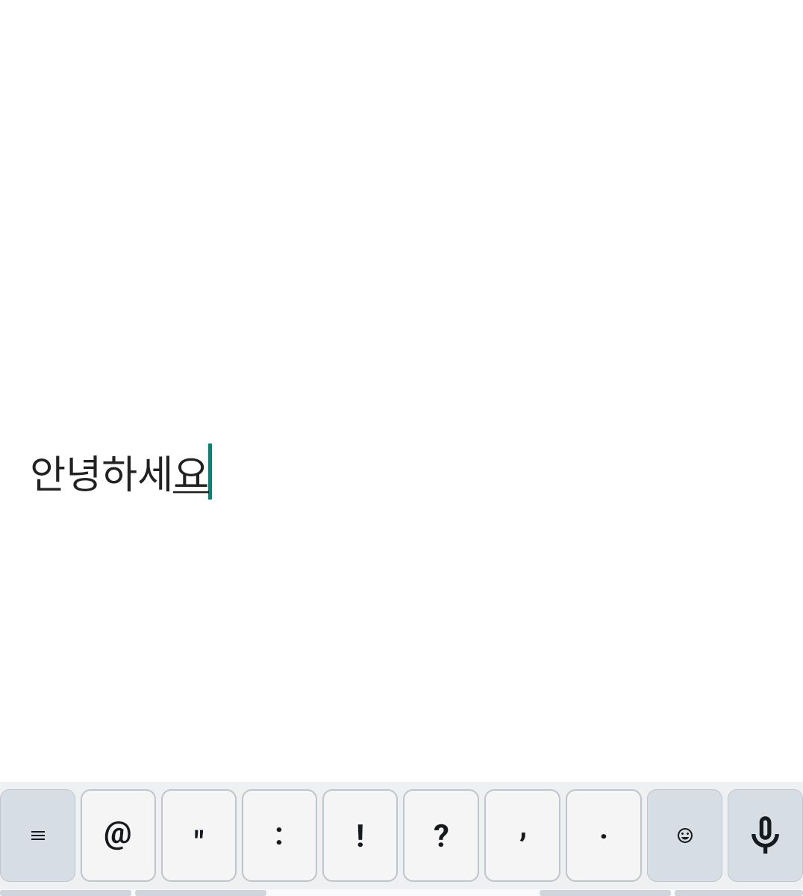
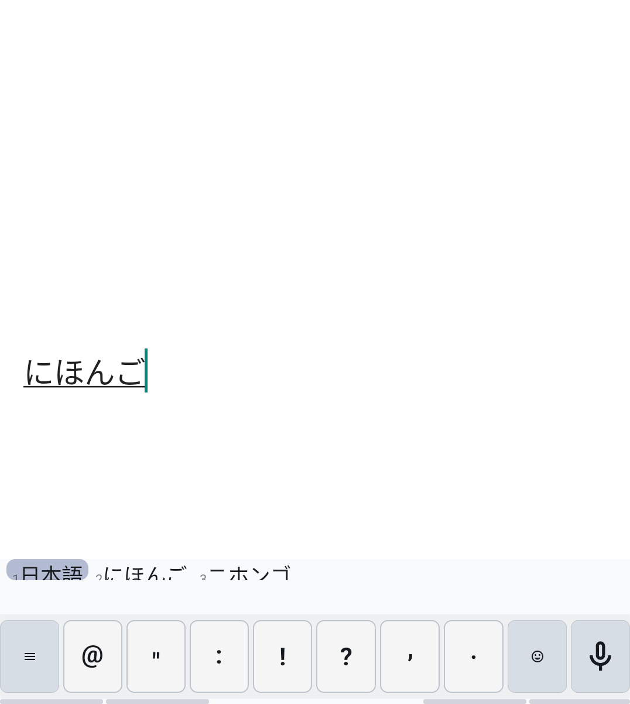
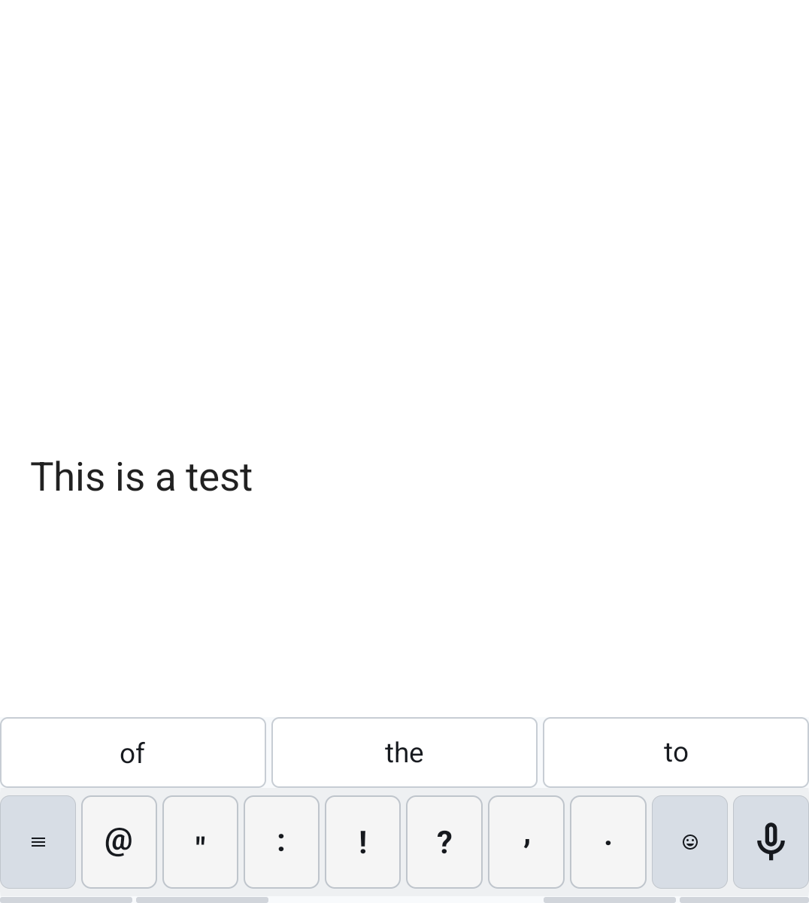
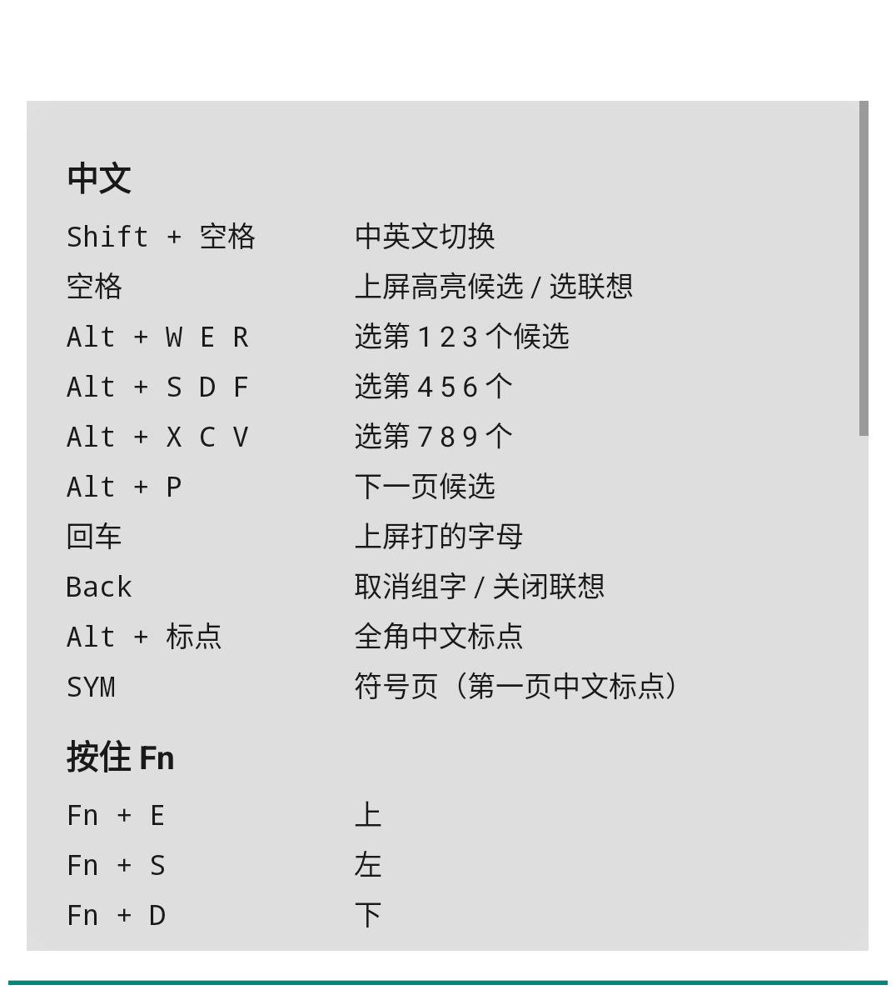
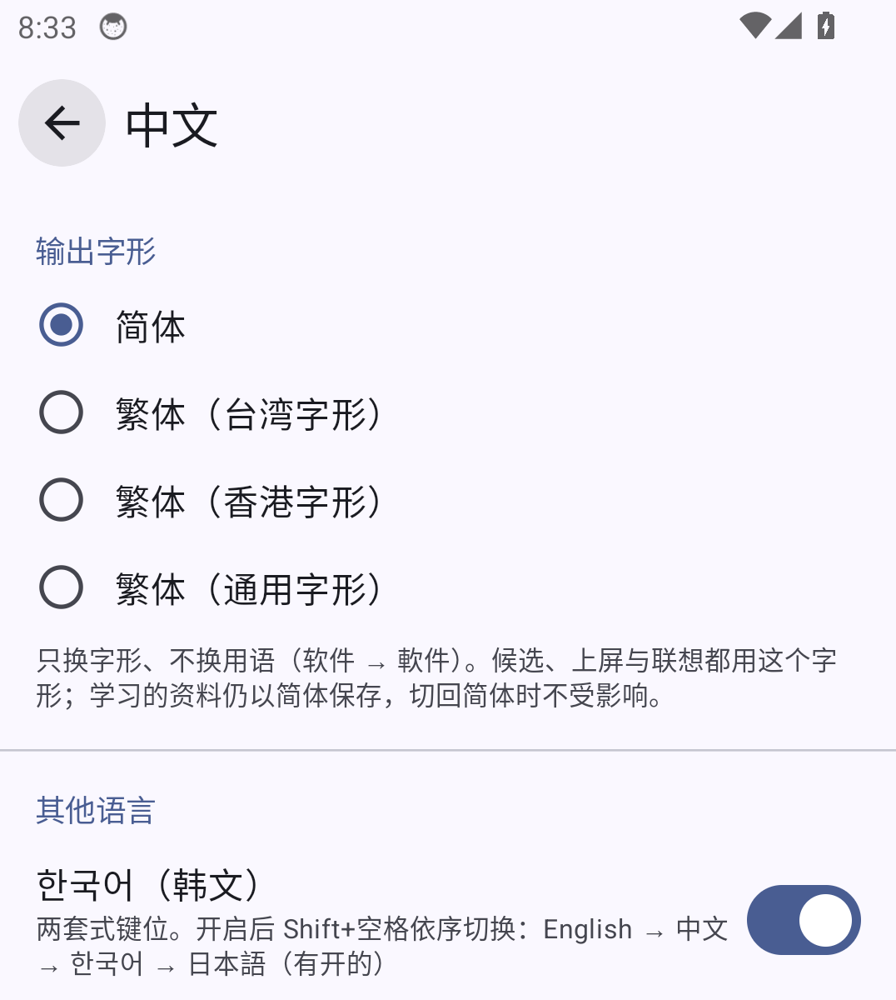
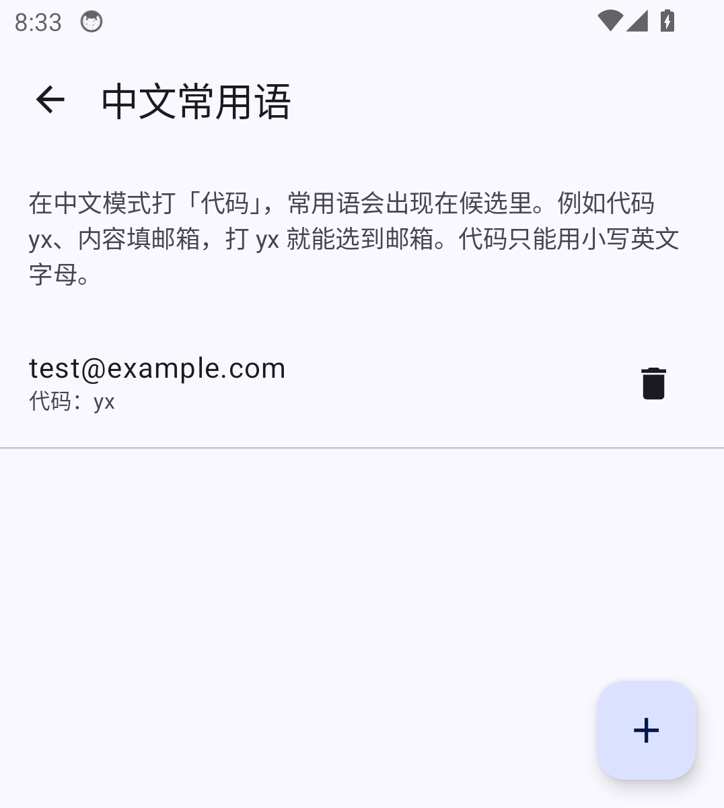

# Qingshu 青书

**English** · [中文](README.zh.md)

**A keyboard for physical-keyboard Android phones, made for the Unihertz Titan 2 Elite: offline Chinese pinyin, English autocorrect, Korean and Japanese — all typed and chosen without leaving the keys.**

Qingshu is a fork of [Plektra](https://github.com/pkb-rocks/plektra) (the successor of Pastiera). It keeps all of Plektra's hardware-keyboard features — modifiers, SYM pages, Nav Mode, snippets, clipboard history — and adds:

- **Chinese pinyin** from the [Qingjian](https://github.com/qingjian-team/qingjian) engine, with candidates picked from the keyboard (Alt + the keys that carry the digits on the Titan), offline next-word association, traditional output and fuzzy pinyin.
- **English autocorrect** from [Numen](https://github.com/jlo-aug/numen), tuned to the slips fingers make on the Titan 2 Elite's keys.
- **Korean** (2-set) and **Japanese** (romaji, kanji from the SKK dictionary) as optional languages.

Typing is processed on the phone: pinyin, association, autocorrect and conversion are all offline. Qingshu has no account or analytics and doesn't check for updates by itself.

[**Download the latest APK**](https://github.com/zhangroley76/Qingshu_ple/releases/latest) · [Key reference (Chinese)](QINGSHU.md) · [Emulator test report](https://github.com/zhangroley76/Qingshu_ple/releases/tag/qingshu-emulator-test)

## Screenshots

Taken on the Android emulator at the Titan 2 Elite's screen size, by `scripts/emulator-screenshots.sh` in CI.

| | |
|:---:|:---:|
| <br>Pinyin: whole-sentence candidates, numbered for Alt + W E R / S D F / X C V | <br>Offline association after a pick |
| <br>Traditional output (Taiwan forms) | <br>English words among pinyin candidates |
| <br>Korean 2-set | <br>Japanese: romaji → kana → kanji |
| <br>English autocorrect ("Thsi" → "This") | <br>Type `/?` anywhere for every shortcut |
| <br>Chinese settings | <br>Phrases: type a code, get the text |

## Features

### Chinese

| | |
| --- | --- |
| Switch languages | **Shift+Space** (or the language key in the bar: 中 / 한 / あ / EN) |
| Pick from the keyboard | **Alt + W E R / S D F / X C V** picks candidates 1–9, the digits printed on those keys. **Space** takes the highlighted one. Hold Alt to pick several in a row |
| Pages and highlight | **Alt+P** next page (wraps); arrow keys, a swipe on the bar, or ‹ › |
| Partial picks | Pick the first words of a long pinyin; the rest stays composing |
| Association | After a pick, likely next words appear; Space or Alt+digit continues, Back dismisses |
| Learning | Words you pick move up; saved when the field or the keyboard closes |
| Traditional output | Taiwan, Hong Kong or standard forms (character forms only, as Qingjian does) |
| Mixed Chinese/English | Typing `hello` in Chinese also offers the English word |
| Fuzzy pinyin, initials | Nine fuzzy pairs (z = zh, n = l, an = ang…); initials alone work (`nh` → 你好) |
| Dictionaries | Qingjian's large general vocabulary plus 11 domain dictionaries (idioms, poetry, places, IT, medicine, law…) |
| Phrases | Give a phrase a code (`yx` → your email) and it becomes a candidate |
| Punctuation | Alt+punctuation gives full-width marks; optional 「」『』 quotes; SYM page 1 is Chinese punctuation |

### Korean and Japanese (optional)

Switch them on in **Settings → 中文 → 其他语言**; Shift+Space then cycles English → 中文 → 한국어 → 日本語.

- **Korean**: 2-set layout; Shift for ㄲ ㄸ ㅃ ㅆ ㅉ ㅒ ㅖ; Backspace removes one stroke at a time.
- **Japanese**: romaji composes hiragana; candidates come from SKK-JISYO.L, word by word, with okurigana (`yomu` → 読む) and hiragana / katakana. Picks are remembered. There is no whole-sentence conversion.

### English

- **Autocorrect from Numen**: missing, extra and swapped letters, neighbouring keys of the Titan 2 Elite, missed spaces and common misspellings (`helo` → hello, `teh` → the, `arguement` → argument), with the words around it. Leaves names, slang, email addresses and links alone.
- **Backspace right after a fix undoes it**; a word you undo twice is learned.
- On Numen's own test chat (12% of words mistyped) the port fixes about 80% of typos and changes about 1 correct word in 1,800. The test runs in CI on every push.

### Keyboard

- **Shift/Alt swap** (Settings → Keyboard → Modifiers) for the Titan's awkward Alt-for-digits.
- **Fn as Ctrl** on the Titan 2 Elite (its Fn key sends a vendor key code): with Settings → Nav Mode → *Ctrl-hold navigation*, Fn + E S D F are the arrows, Fn + W/R and U/I select, Fn + A/C/X/V/Z edit.
- Chinese, Korean and Japanese never trigger English auto-capitalisation or autocorrect; password and email fields stay plain. Browser address bars accept Chinese, Korean and Japanese (for searches) with half-width punctuation.
- Typing stats (counts only) in Settings → 中文.

## Install

1. Download `qingshu-26.09.N.apk` from the [latest release](https://github.com/zhangroley76/Qingshu_ple/releases/latest) and install it.
2. In Android settings, enable **青书 Qingshu** as a keyboard and select it.
3. Press **Shift+Space** to switch to Chinese.

Update by installing over the old version; don't uninstall first, or your learned words and settings are lost.

**Automatic updates**: add `https://github.com/zhangroley76/Qingshu_ple` to [Obtainium](https://github.com/ImranR98/Obtainium). It follows the numbered releases (`v26.09.N`).

The app ID is `io.github.zhangroley76.qingshu`, so it installs next to Plektra. The APK is about 95 MB, mostly dictionaries and the language model.

## Status

- In daily use on a Titan 2 Elite: Chinese input, candidate selection and the Shift/Alt swap are confirmed on the device. The newer features (Fn arrows, English autocorrect, traditional output, dictionaries, Korean, Japanese) are tested on the emulator and still being tried on the phone.
- Every push is built by GitHub Actions and tested on an Android emulator with injected key events (34 checks: pinyin, association, phrases, traditional output, fuzzy pinyin, English autocorrect, Korean, Japanese, shortcuts). The emulator runs the minified release code.

## Build

GitHub Actions builds every push to `pinyin` and publishes the APK. Locally you need JDK 17+ and the Android SDK (platform 36):

```sh
scripts/fetch-qingjian-engine.sh --with-lm    # Qingjian v0.3.2 dictionaries and language model
scripts/fetch-japanese-dictionary.sh          # SKK-JISYO.L for Japanese
ANDROID_NDK_HOME=/path/to/ndk scripts/build-qingjian-engine.sh arm64-v8a   # engine with Qingshu's patches
./gradlew assembleStableDebug
```

Qingshu's changes to Qingjian (offline association, traditional association) are patches in [`third_party/qingjian/`](third_party/qingjian/).

## Credits and licence

- [Plektra](https://github.com/pkb-rocks/plektra) by Patrick Zauner, from Pastiera by Andrea Palumbo (PalSoftware)
- [Qingjian 青简](https://github.com/qingjian-team/qingjian): pinyin engine, dictionaries and language model
- [Numen](https://github.com/jlo-aug/numen): English autocorrect engine and data
- [SKK dictionary](https://github.com/skk-dev/dict) (SKK-JISYO.L): Japanese conversion

Data sources and their licences are listed in [THIRD_PARTY_NOTICES.md](THIRD_PARTY_NOTICES.md). Qingshu is free software under the [GPL-3.0](LICENSE). It is not an official release of Plektra, Qingjian or Numen; please report Qingshu problems here, not upstream.
