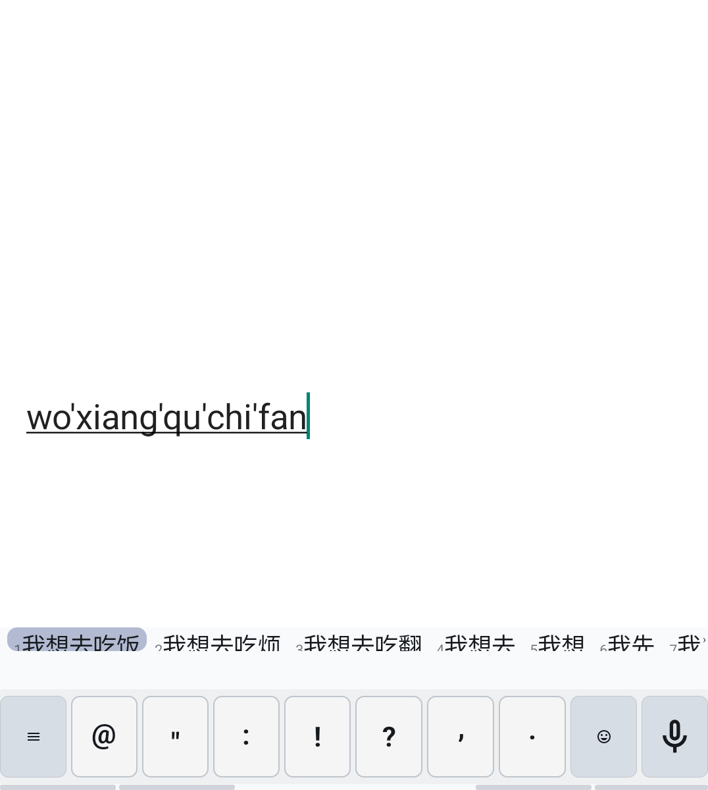
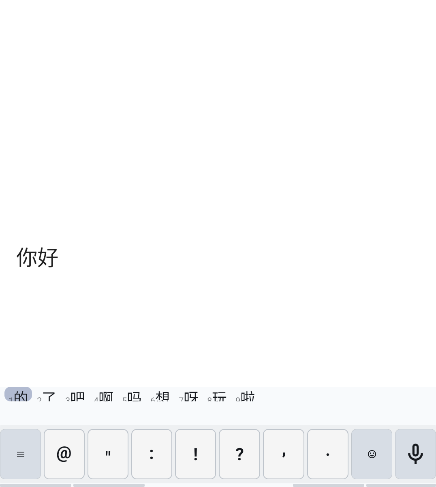
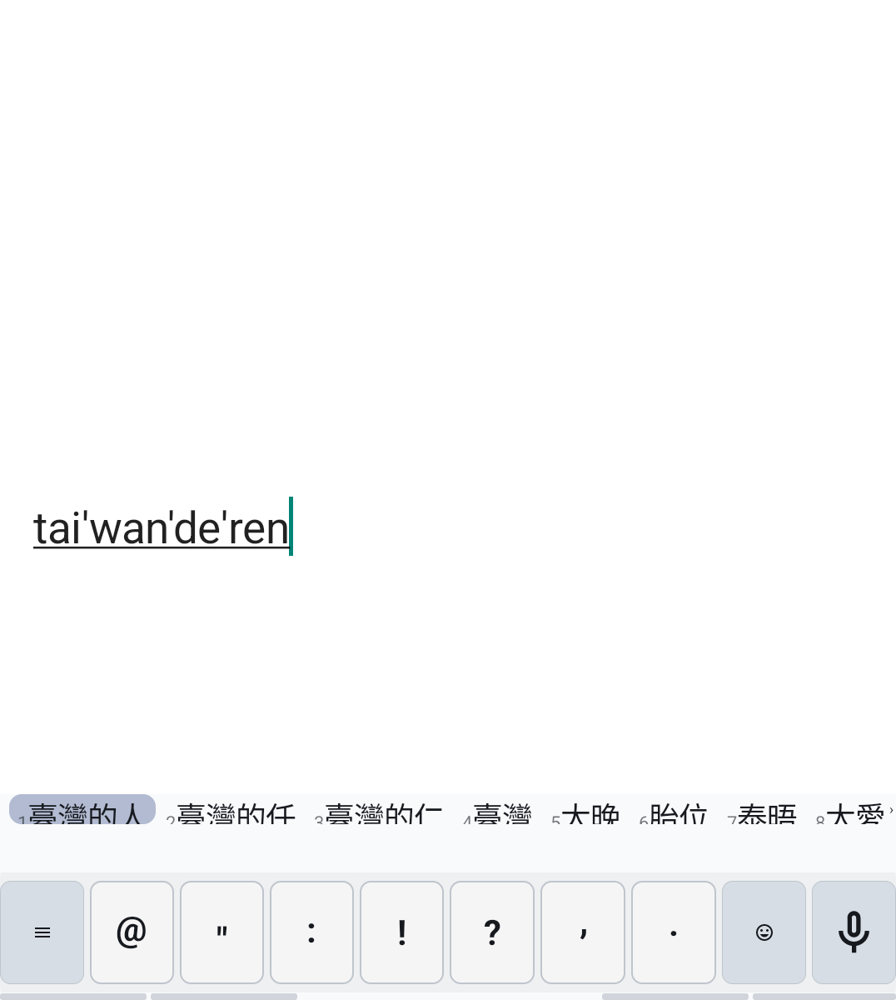
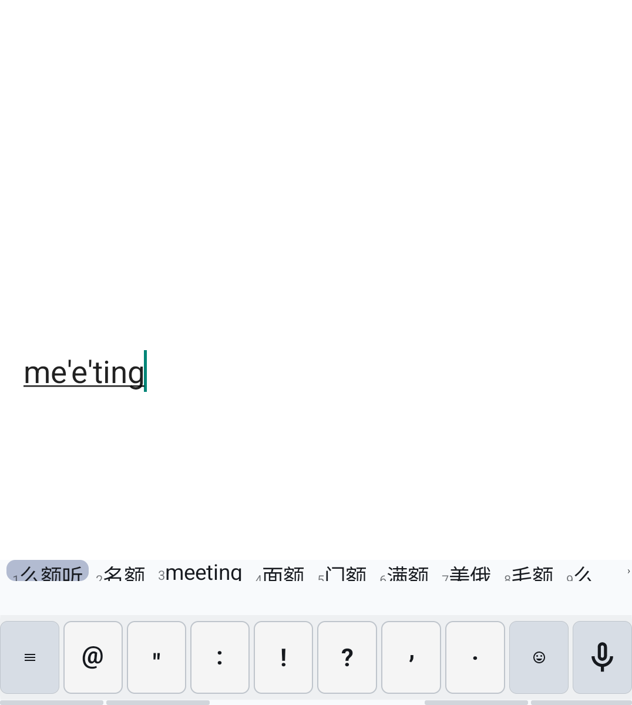
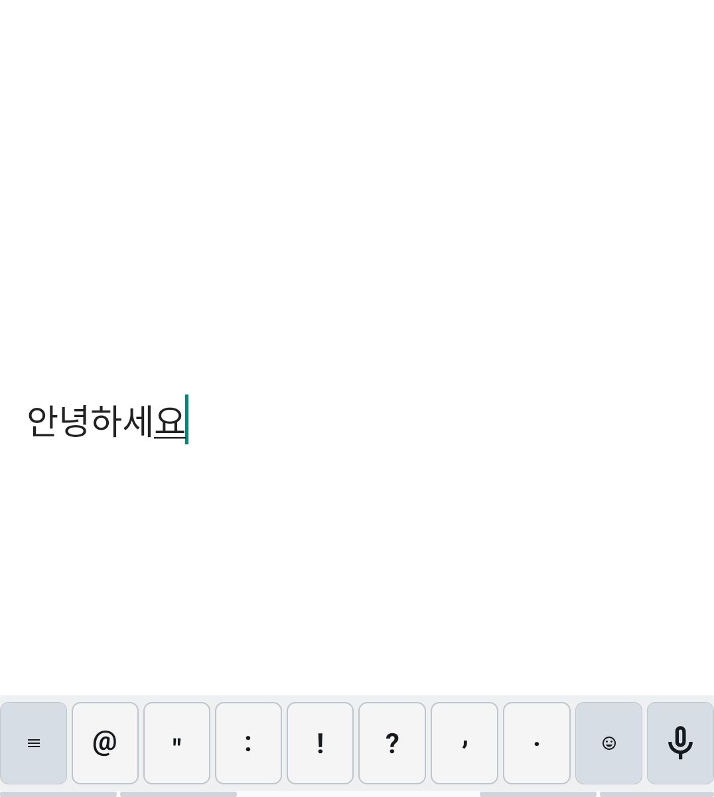
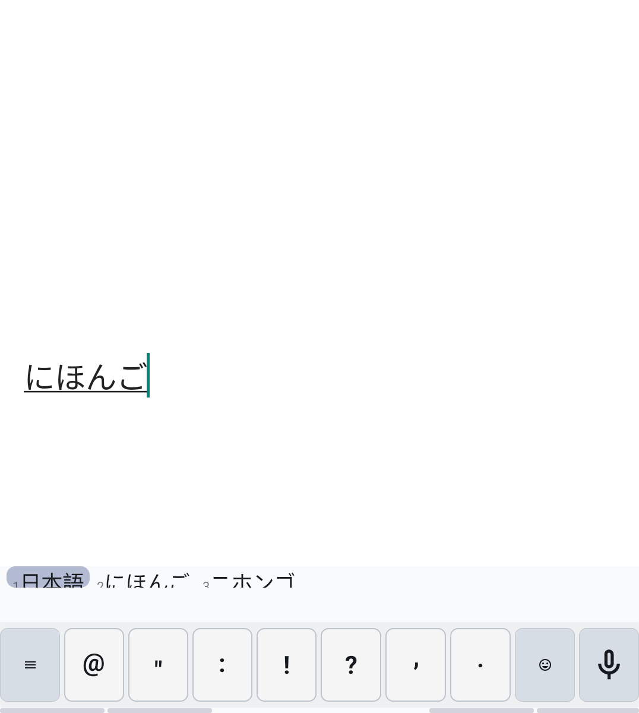
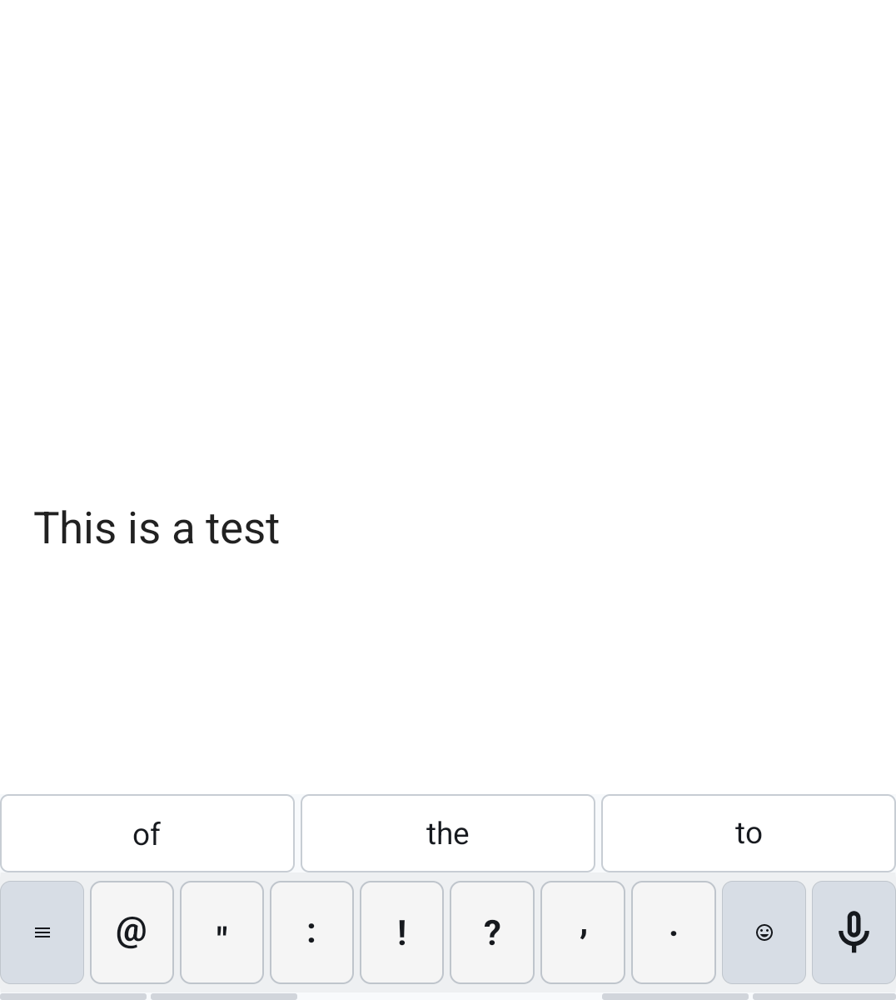
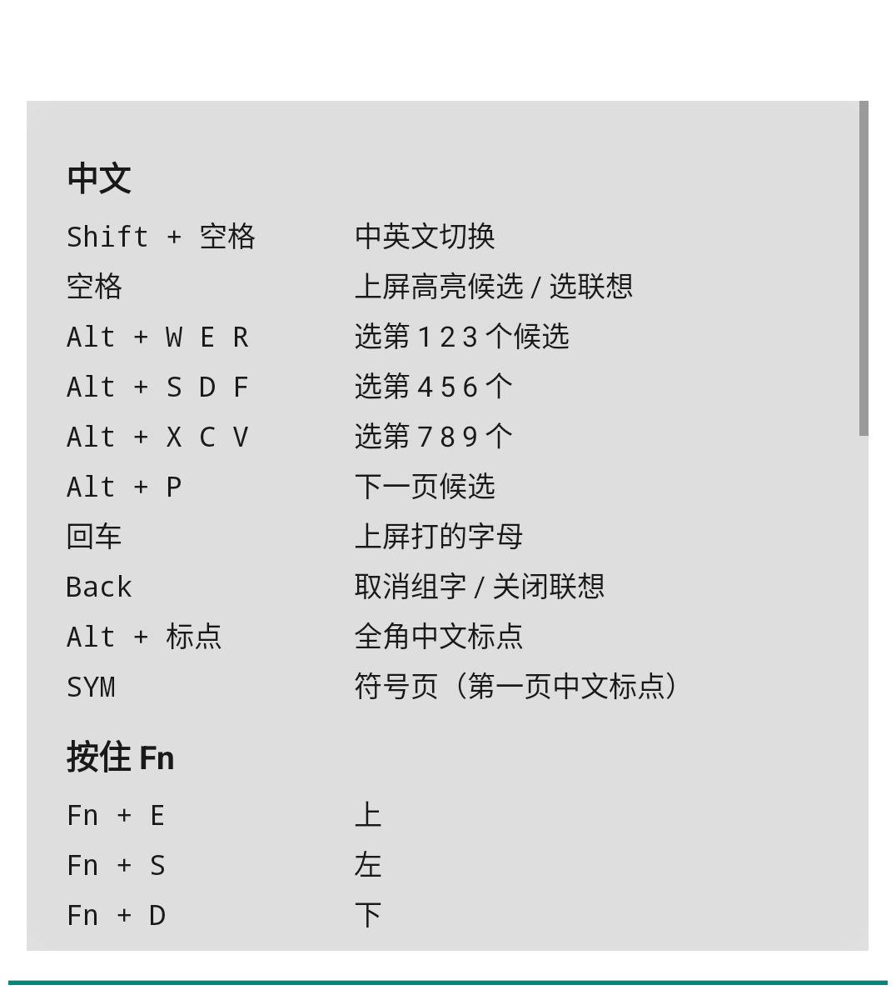
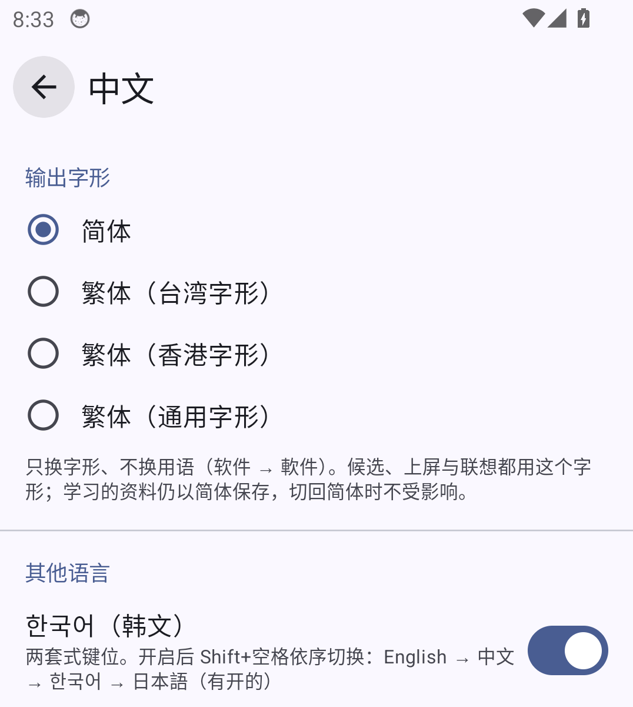
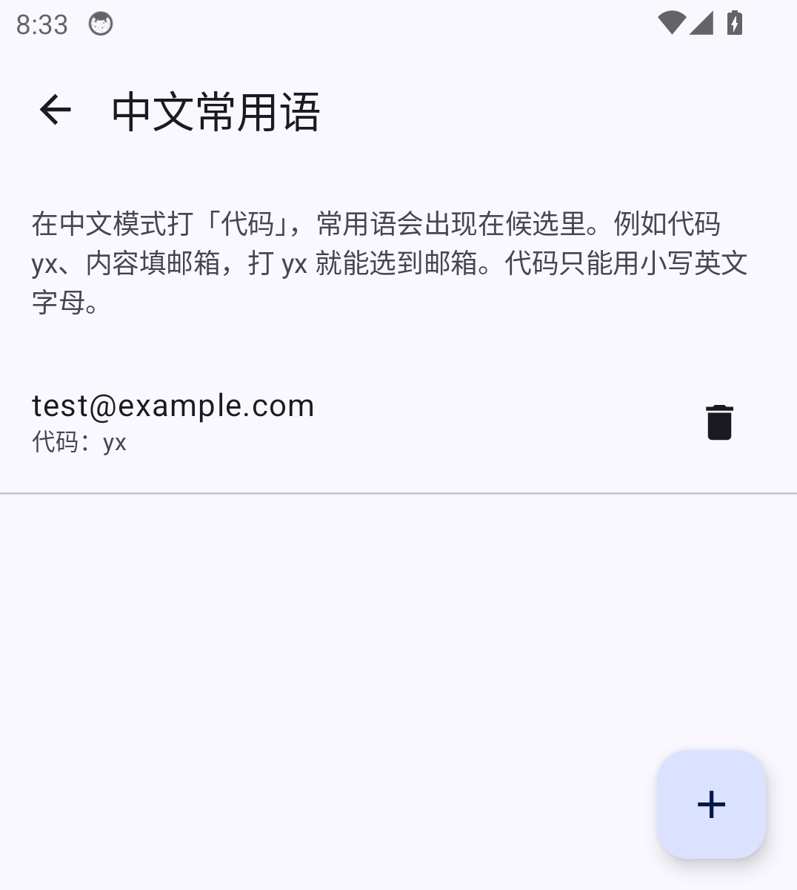

# 青书 Qingshu

[English](README.md) · **中文**

**为实体键盘 Android 手机打造的输入法，针对 Unihertz Titan 2 Elite：离线中文拼音、英文自动纠错、韩文与日文，选字都在键盘上完成，手不用离开按键。**

青书是 [Plektra](https://github.com/pkb-rocks/plektra)（Pastiera 的后续项目）的分支。它保留 Plektra 完整的实体键盘功能（修饰键、SYM 符号页、导航模式、文字片段、剪贴板历史），再加上：

- **中文拼音**：引擎来自 [青简 Qingjian](https://github.com/qingjian-team/qingjian)。用 Alt 加 Titan 上印着数字的那几个键选字；离线联想；繁体输出；模糊音。
- **英文自动纠错**：来自 [Numen](https://github.com/jlo-aug/numen)，按 Titan 2 Elite 的键位估计手指打错的情形。
- **韩文**（两套式）与 **日文**（罗马字，SKK 词典转汉字），可选开启。

打字都在手机上处理：拼音、联想、纠错和转换全部离线运作。青书没有帐号或使用统计，也不会自己检查更新。

[**下载最新 APK**](https://github.com/zhangroley76/Qingshu_ple/releases/latest) · [完整按键说明](QINGSHU.md) · [模拟器测试报告](https://github.com/zhangroley76/Qingshu_ple/releases/tag/qingshu-emulator-test)

## 截图

在 Android 模拟器上以 Titan 2 Elite 的屏幕尺寸截取，由 CI 里的 `scripts/emulator-screenshots.sh` 产生。

| | |
|:---:|:---:|
| <br>拼音整句候选，编号对应 Alt + W E R / S D F / X C V | <br>上屏后的离线联想 |
| <br>繁体输出（台湾字形） | <br>拼音候选里也有英文单字 |
| <br>韩文两套式 | <br>日文：罗马字 → 假名 → 汉字 |
| <br>英文自动纠错（Thsi → This） | <br>任何输入框打 `/?` 看所有快捷键 |
| <br>中文设置 | <br>常用语：打代码出内容 |

## 功能

### 中文

| | |
| --- | --- |
| 切换语言 | **Shift+空格**，或点键盘栏的语言按钮（中 / 한 / あ / EN） |
| 键盘选字 | **Alt + W E R / S D F / X C V** 选第 1–9 个候选，就是这些键上印的数字；**空格**上屏高亮的候选；按住 Alt 可以连续选 |
| 翻页与高亮 | **Alt+P** 翻页（到最后一页回第一页）；方向键、在键盘栏左右滑，或点 ‹ › |
| 分段选字 | 长串拼音可以先选前面的词，剩下的继续组字 |
| 联想 | 上屏后显示常接在后面的词，空格或 Alt+数字接下去，Back 关闭 |
| 学习 | 选过的词越来越靠前；切换输入框或收起键盘时存档 |
| 繁体输出 | 台湾、香港或通用字形（与青简一样只换字形、不换用语） |
| 中英混打 | 中文模式打 `hello`，候选里也有英文单字 |
| 模糊音、简拼 | 九组模糊音（z = zh、n = l、an = ang…）；只打声母也行（`nh` → 你好） |
| 词库 | 青简的通用大词库，加上成语、诗词、地名、IT、医学、法律等 11 个专业词库 |
| 常用语 | 给常用语设代码（`yx` → 你的邮箱），打代码就出现在候选 |
| 标点 | Alt+标点出全角标点；可选「」『』直角引号；SYM 第一页是中文标点 |

### 韩文与日文（可选）

在 **设置 → 中文 → 其他语言** 开启，之后 Shift+空格依次切换 English → 中文 → 한국어 → 日本語。

- **韩文**：两套式键位；Shift 打 ㄲ ㄸ ㅃ ㅆ ㅉ ㅒ ㅖ；退格一次删一笔。
- **日文**：罗马字组成平假名，候选来自 SKK-JISYO.L，按单词转换，含送假名（`yomu` → 読む），也有平假名、片假名；选过的写法会记住。没有整句转换。

### 英文

- **Numen 的自动纠错**：漏字母、多字母、字母颠倒、按到 Titan 2 Elite 的隔壁键、漏空格、常见拼错（`helo` → hello、`teh` → the、`arguement` → argument），并参考前后文。名字、俚语、电邮地址和网址不改。
- **纠正后马上按退格就还原**；同一个字还原两次会被学起来。
- 在 Numen 自带的聊天测试（12% 的字打错）上，移植后修正约 80% 的错字，正确的字被改错约 1/1800。这项测试每次推送都在 CI 上跑。

### 键盘

- **Shift/Alt 对调**（设置 → Keyboard → Modifiers），解决 Titan 用 Alt 打数字不顺手的问题。
- Titan 2 Elite 的 **Fn 当成 Ctrl**（它的 Fn 键送出厂商自定义键码）：在 设置 → Nav Mode 打开 *Ctrl-hold navigation* 后，Fn + E S D F 是方向键，Fn + W/R、U/I 选取文字，Fn + A/C/X/V/Z 编辑。
- 中文、韩文、日文都不会触发英文的自动大写和纠错；密码、网址、电邮栏位保持原样。
- 打字统计（只记数量）：设置 → 中文。

## 安装

1. 从[最新版本](https://github.com/zhangroley76/Qingshu_ple/releases/latest)下载 `qingshu-26.09.N.apk` 并安装。
2. 在系统设置里启用「青书 Qingshu」输入法，并设为当前输入法。
3. 按 **Shift+空格** 切换到中文。

更新时直接覆盖安装，不要先卸载，否则学到的词和设置都会不见。

**自动更新**：在 [Obtainium](https://github.com/ImranR98/Obtainium) 加入 `https://github.com/zhangroley76/Qingshu_ple`，它会追踪编号版本（`v26.09.N`）。

App ID 是 `io.github.zhangroley76.qingshu`，可以和 Plektra 同时安装。APK 约 95 MB，主要是词库和语言模型。

## 目前状态

- 在 Titan 2 Elite 上日常使用：中文输入、选字、Shift/Alt 对调已在实机确认。较新的功能（Fn 方向键、英文纠错、繁体、词库、韩文、日文）通过了模拟器测试，实机还在试用中。
- 每次推送都由 GitHub Actions 编译，并在 Android 模拟器上用注入按键测试（34 项：拼音、联想、常用语、繁体、模糊音、英文纠错、韩文、日文、快捷键）。模拟器测试跑的是经过压缩的正式版程序。

## 编译

推送到 `pinyin` 分支时，GitHub Actions 会编译并发布 APK。本地编译需要 JDK 17 以上和 Android SDK（platform 36）：

```sh
scripts/fetch-qingjian-engine.sh --with-lm    # 青简 v0.3.2 的词库与语言模型
scripts/fetch-japanese-dictionary.sh          # 日文用的 SKK-JISYO.L
ANDROID_NDK_HOME=/path/to/ndk scripts/build-qingjian-engine.sh arm64-v8a   # 加上青书补丁的引擎
./gradlew assembleStableDebug
```

青书对青简源码的修改（离线联想、联想的繁体转换）放在 [`third_party/qingjian/`](third_party/qingjian/)。

## 致谢与授权

- [Plektra](https://github.com/pkb-rocks/plektra)：Patrick Zauner；前身是 Andrea Palumbo（PalSoftware）的 Pastiera
- [青简 Qingjian](https://github.com/qingjian-team/qingjian)：拼音引擎、词库与语言模型
- [Numen](https://github.com/jlo-aug/numen)：英文自动纠错引擎与资料
- [SKK 词典](https://github.com/skk-dev/dict)（SKK-JISYO.L）：日文转换

资料来源与授权见 [THIRD_PARTY_NOTICES.md](THIRD_PARTY_NOTICES.md)。青书以 [GPL-3.0](LICENSE) 发布，不是 Plektra、青简或 Numen 的官方版本，问题请回报到这里，不要回报给上游项目。
